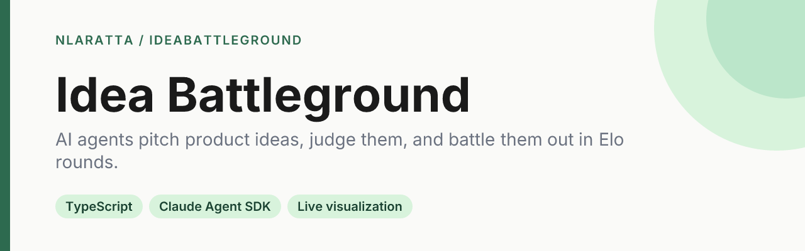
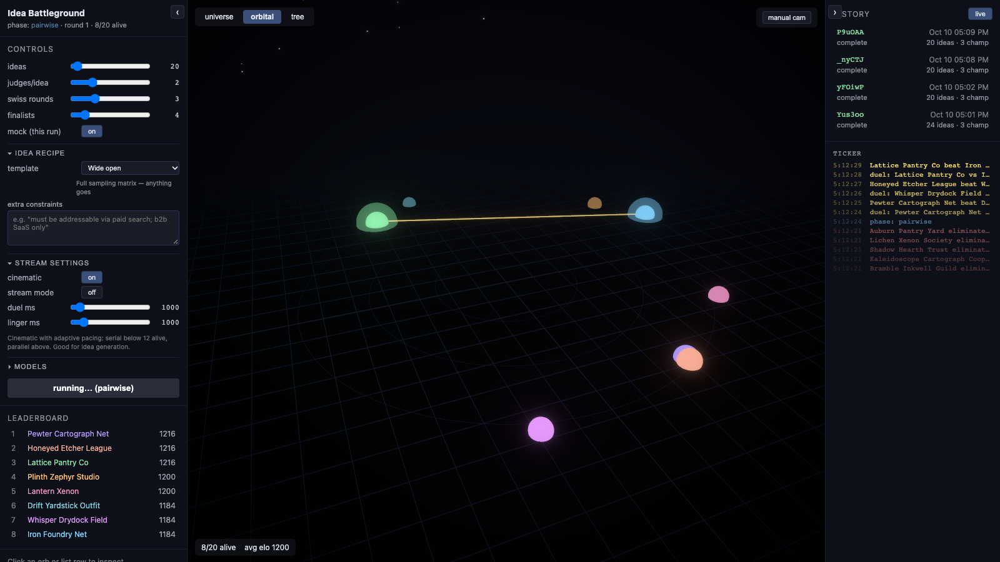
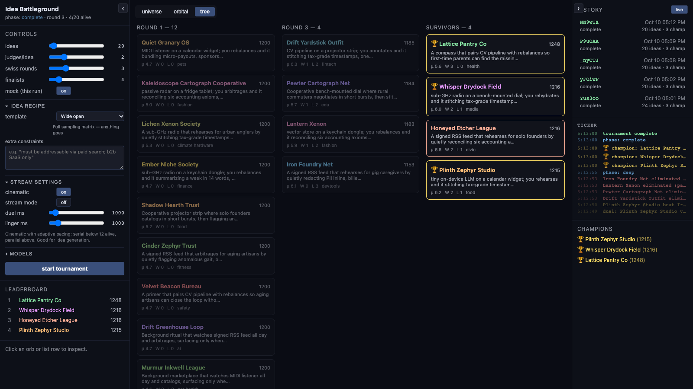

<p align="center">
  
</p>

<p align="center">
  <a href="https://github.com/nlaratta/IdeaBattleGround/actions/workflows/ci.yml"></a>
  <a href="LICENSE"></a>
</p>

An AI idea colosseum. Agents generate product ideas from a structured sampling matrix, cull duplicates, score the rest on a rubric, battle the survivors in Swiss-style Elo rounds, and a deep judge crowns champions, all visualized live in the browser.

<p align="center">
  
</p>

## Quick start

Needs Node 22 or newer. This runs fully offline in mock mode, no keys or login:

```bash
git clone https://github.com/nlaratta/IdeaBattleGround.git
cd IdeaBattleGround
npm install
npm run dev
```

Open <http://localhost:5173> and press **start tournament**. The API runs on `:8787`.

### Live mode (real Claude)

Live mode uses the [Claude Agent SDK](https://docs.claude.com/en/docs/claude-code/sdk) with your local Claude Code login, so no API key is needed. Run `claude` once and `/login` if you haven't, then:

```bash
MOCK_MODE=false npm run dev
```

or copy `.env.example` to `.env` and set `MOCK_MODE=false`. The **mock (this run)** toggle in the UI follows the server setting and can override it per run. Live runs spend your Claude usage: a 6-idea tournament is roughly 16 model calls, a 30-idea default one a few hundred.

To check the live path without the UI, run a tiny tournament from the command line:

```bash
MOCK_MODE=false IDEAS=6 JUDGES=1 ROUNDS=2 FINALISTS=2 npm --workspace server run smoke:tournament
```

### Tests

```bash
npm test                  # everything
npm run test:unit         # Elo, Swiss pairing, dedupe, rubric aggregation
npm run test:integration  # full mock tournament, headless
```

## How it works

1. **Generate.** Ideas come from a sampling matrix (domain, audience, business model, constraint, time horizon, vibe, persona), so variety is structural rather than random words. Recipe templates and free-text constraints bias a run toward a theme.
2. **Dedupe and rubric.** Near-duplicates are dropped with token Jaccard similarity. Each remaining idea is scored by N independent judges on novelty, feasibility, market, weirdness and buildability, critique first, and the scores are averaged. The top 40% (never fewer than the finalist count) survive.
3. **Battle.** Survivors fight pairwise in Swiss rounds: sorted by Elo, paired with the closest-rated opponent they have not met, K=32 updates after each judged duel.
4. **Deep review.** The top finalists by Elo get a long-form review (strongest point, fatal flaw, verdict, score). The top three by deep score are crowned.
5. **Watch it.** Every step is an event on an in-memory bus streamed over SSE (late joiners get the backlog replayed) and persisted to SQLite, so past tournaments can be replayed from the History panel.

<p align="center">
  
  
</p>

The web UI has three views: **universe** (a cinematic, paced battle mode with duel cards, taunts and a champion reveal), **orbital** (a 3D field of orbs sized by Elo, with auto-follow or manual camera) and **tree** (a column per round: duplicates, culls, survivors, champions). Side panels hold the leaderboard, ticker, an inspector with rubric scores and sampling-cell metadata, run controls, and history.

### Roadmap (not built yet)

- Embedding-based layout (orbs are currently placed by category cluster plus jitter).
- Mutation and crossover rounds that rewrite or combine survivors.
- A build-on-stream phase where a champion gets scaffolded and deployed by an agent.
- Faster near-duplicate detection (MinHash or embeddings) for tens of thousands of ideas.

## Configuration

Server settings, in `.env` or the environment (see `.env.example`):

| Variable | Default | Meaning |
| --- | --- | --- |
| `MOCK_MODE` | `true` | `false` calls live Claude |
| `GENERATOR_MODEL`, `JUDGE_MODEL`, `DEEP_JUDGE_MODEL` | `sonnet`, `sonnet`, `opus` | model aliases or full IDs (live) |
| `GENERATION_CONCURRENCY`, `JUDGING_CONCURRENCY` | `6` | parallel LLM calls |
| `PORT`, `DATA_DIR` | `8787`, `./data` | API port and SQLite location |

The UI sets ideas, judges per idea, Swiss rounds, finalists, pacing and per-phase models for each run.

## Project structure

```
server/            Express + SSE + Agent SDK + tournament logic
  src/llm/         provider interface, Agent SDK and mock providers
  src/generation/  sampling matrix, templates, generator prompts
  src/judging/     rubric, Swiss pairing and Elo, deep review, dedupe
  src/db/          SQLite persistence
  test/            unit tests and the mock-tournament integration test
web/               Vite + React + three.js UI
  scripts/         capture-media.mjs regenerates docs/media
docs/              architecture notes and README media
```

See [docs/ARCHITECTURE.md](docs/ARCHITECTURE.md) for the design notes. To regenerate the README media, run `npm run dev` and then `npm run media` (needs Google Chrome and ffmpeg).

## License

[MIT](LICENSE) © Noah Laratta
